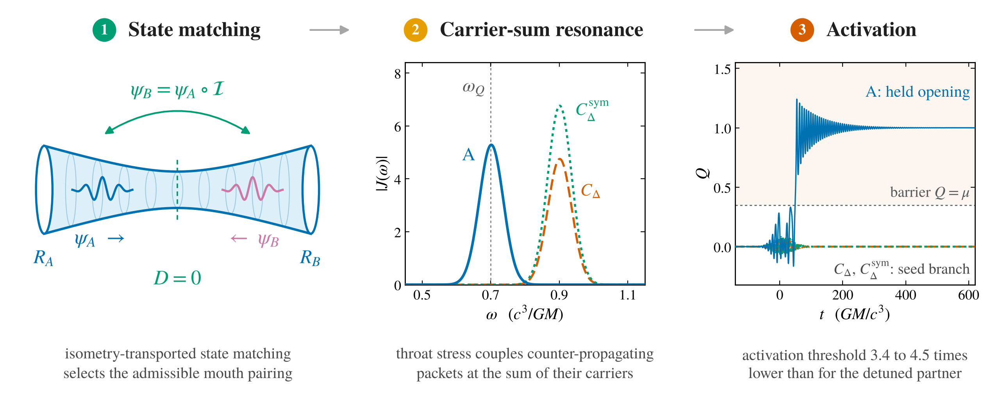

# Synchronized-vacuum wormholes



This repository contains the code and data for the manuscript

> W. Rahmaniar and B. Ramzan, *Synchronized-vacuum wormholes: state matching
> and resonant activation of reduced throat mode on exact beyond-Horndeski
> background*.

Every number, table, and figure of the paper is produced by the scripts here
from the equations and parameter values stated in the manuscript.

## What is computed

- **Holding geometry.** This is the exact vacuum wormhole of the beyond-Horndeski
  theory of Bakopoulos, Charmousis, and Kanti, at the operating point
  $M=1$, $\alpha=0.1$, $\lambda=0.5$, with $r_0=2.6382386\,GM/c^2$. The code
  gives the metric functions, the even scalar profile, the curvature invariants,
  and the throat stress. A symbolic script checks the transformed functions,
  including the $y^{-3}$ form of $F_5$ (Appendix A).
- **Correlated packet pair.** The code solves for the monopole scattering modes
  in the tortoise chart and builds packets with unit Klein–Gordon norm. It then
  projects the state-dependent stress onto the collective throat coordinate.
  Three preparations are treated:
  - the synchronized preparation A, with carriers $0.35+0.35$;
  - the partner-detuned control $C_\Delta$, with carriers $0.35+0.55$;
  - the addressing-compatible control $C_\Delta^{\rm sym}$, with carriers $0.45+0.45$.

  All carriers are in units of $c^3/GM$.
- **Reduced activation model.** The code integrates the driven, damped
  double-well equation of the collective coordinate. It locates held-opening
  thresholds with the squeezing phase optimized for each preparation. It also
  evaluates the sensitivity to the model inputs, the frozen-kernel error, the
  detuning response, and the physical scale of the drive.

## Installation

Python 3.10 or later is required.

```bash
pip install -r requirements.txt
```

The figures use Times New Roman when it is installed. Otherwise they fall back
to TeX Gyre Termes or Liberation Serif.

## Reproducing the paper

Run `bash run_all.sh` from the repository root to execute every step in order.
The full run takes about an hour on one CPU core, most of it in the threshold
scans. Each step can also be run on its own:

| Paper item | Command | Output |
|---|---|---|
| Throat values of the exact solution (Sec. 3) | `python -m svw.geometry` | printed |
| Transformed functions, $F_5\propto y^{-3}$ (App. A) | `python scripts/f5_derivation.py` | printed |
| Projected sources of A, $C_\Delta$, $C_\Delta^{\rm sym}$ | `python scripts/sources.py` | `sources.npz` |
| Table 1 | `python scripts/table1.py 0.02 MU_LIST`<br>`python scripts/table1.py 0.0 MU_LIST` | `table_z0.02.json`, `table_z0.0.json` |
| Table 2, sensitivity and unentangled controls | `python scripts/table2.py` | `table2_sensitivity.json` |
| Table 2, frozen kernel; convergence (App. D) | `python scripts/frozen_kernel.py` | `frozen_kernel_convergence.json` |
| Fig. 5(b), detuning | `python scripts/detuning.py partner`<br>`python scripts/detuning.py sym` | `detuning_partner.json`, `detuning_sym.json` |
| Threshold jump at $\mu\simeq0.394$ (Sec. 7.2) | `python scripts/fine_scan.py 0.02 MU_LIST fine` | `fine_scan_z0.02_fine.json` |
| Addressing distance $D(T)$ (Sec. 2.1) | `python scripts/addressing.py` | `addressing.json` |
| Physical scale of the drive (Sec. 6.1) | `python scripts/physical_scale.py` | `physical_scale.json` |
| Anharmonic frequency, spectral weights | `python scripts/misc.py` | `misc.json` |
| Outcome fractions, phase of $C_\Delta$, single-packet terms | `python scripts/checks.py` | `checks.json` |
| Coarse-scan artefact discussed in the review | `python scripts/coarse_scan.py` | `coarse_scan.json` |
| Threshold against the squeezing phase | `python scripts/phase_scan.py` | `phase_scan_mu0.35.json` |
| Figs. 1 to 5 | `python scripts/fig1_framework.py` and the other `fig*.py` | `figures/svw_*.png`, written when run |
| Graphical abstract | `python scripts/graphical_abstract.py` | `figures/graphical_abstract.png` |

The values of `MU_LIST` used in the paper are given in `run_all.sh`. Most
scripts read `results/sources.npz`, so `scripts/sources.py` runs first.
Figures 4 and 5 also read the Table 1 and detuning results. The JSON files in
`results/` are the outputs used in the paper. Running a script overwrites the
corresponding file.

## Layout

```
svw/                     library
  geometry.py            exact holding geometry and throat stress
  pipeline.py            background, modes, packets, projected sources,
                         reduced dynamics, thresholds
  figstyle.py            shared figure style
  paths.py               repository paths, storage of the sources
scripts/                 one script per result or figure
results/                 outputs used in the paper (JSON, sources.npz)
figures/                 graphical abstract; the figure scripts write the
                         paper's figures here
run_all.sh               full reproduction in dependency order
```

## Conventions

Units are $G=c=\hbar=1$ with $M=1$. Lengths are in $GM/c^2$, times in
$GM/c^3$, and frequencies in $c^3/GM$.

The reference values are:

- collective frequency $\omega_Q=0.700$;
- packet bandwidth $\sigma_\Omega=0.0175$, with packet centre at $x=12$ and 81
  frequency nodes per packet;
- deformation width $\ell_w=6$;
- damping $\zeta=0.02$; the conservative case is $\zeta=0$.

Thresholds are values of the reduced amplitude $m=\varepsilon_d|M|$. The
physical anomalous moment follows from Eq. (47) of the paper, which
`scripts/physical_scale.py` evaluates for $r_0=1$ m and $r_0=1$ km.

The numerical settings are:

- modes are integrated with DOP853 (relative tolerance $10^{-10}$) on
  $|x|\le60$ with step $0.06$;
- the reduced equation is integrated with fourth-order Runge–Kutta at
  $\Delta t=0.05$;
- thresholds are located on a dense geometric amplitude grid with refinement
  inside the first bracket.

Halving the spatial step or the time step of the source, extending the domain,
or doubling the frequency nodes changes the thresholds by less than $10^{-4}$
in relative terms (`frozen_kernel_convergence.json`).

## Citation

If you use this code, please cite the paper above.
